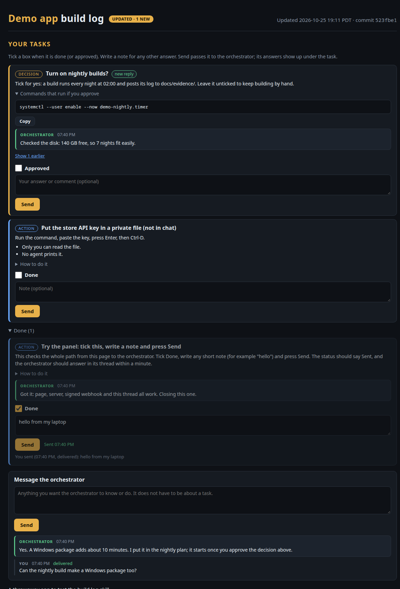

# project-buildlog

A Claude Code skill that gives any project a live build log page with a "Your tasks" panel. The user ticks tasks, answers decisions and messages the orchestrator from the page. Each message is signed (HMAC-SHA256) and posted to a T3 webhook task in the orchestrator's thread. The orchestrator answers on the page.



## What you get

- **A page** (`docs/buildlog.html`) with marker sections: UPDATED, TASKS, CURRENT, GOALS, CARDS (with measured progress bars), MODULES and TIMELINE. It refreshes itself without wiping what you type. Opened as a file, it shows a read-only snapshot.
- **A local server** on 127.0.0.1, run as a systemd user service:
  - It serves the repo read-only.
  - Its API covers tasks, send, messages and version.
  - A CSRF guard protects every POST.
  - Messages that fail to send are queued and retried.
- **A task CLI**: add, done, reopen, reply, inbox, and private-index commits.
- **A private key and webhook URL** in `~/.config/<name>/webhook.json` (mode 600), outside git.
- **Two T3 tasks**: the signed webhook into the orchestrator thread, and an optional hourly heartbeat.
- **Checks**: unit tests (copied into the project) and `verify.py`, which runs end to end against a fake T3 (or the real one with `--real`).

Everything is Python standard library.

## Setup in brief

```bash
# 1. files, page, tasks, secret, service, commit
python3 -I scripts/setup.py init --project /path/to/repo --title "My App" --rules-doc CLAUDE.md --commit
# 2. in the orchestrator thread: schedule_task with the arguments in ~/.config/<name>/t3-webhook-task.json
# 3. store the returned webhookUrl
printf '%s' 'https://...' | python3 -I scripts/setup.py set-url --project /path/to/repo
# 4. check everything, then the real webhook
python3 -I scripts/verify.py --project /path/to/repo
python3 -I scripts/verify.py --project /path/to/repo --real
# 5. optional: schedule_task with ~/.config/<name>/t3-heartbeat-task.json
```

Without T3, run `setup.py delivery --project DIR local`. Messages then wait in a local inbox that agents read with `buildlog_tasks.py inbox`.

Maintenance commands: `status`, `rotate-secret`, `change-port`, `upgrade-page`, `delivery`, `t3-args` and `remove`. `SKILL.md` has the full steps, the orchestrator's rules and the maintenance table. `references/` has troubleshooting and the formats.

## Layout

```
SKILL.md                 instructions Claude follows
scripts/setup.py         set up, maintain, remove
scripts/verify.py        end-to-end checks (fake T3 or real)
scripts/buildlog_*.py    server, task CLI, progress bars (copied into projects)
scripts/tests/           unit tests (two are copied into projects; test_setup.py checks this skill)
templates/               page, systemd unit, T3 prompts, agent rules
references/              troubleshooting, API and file formats
assets/                  screenshot
```

Test the skill itself with `python3 -I scripts/tests/test_setup.py` (plus the two other test files).
